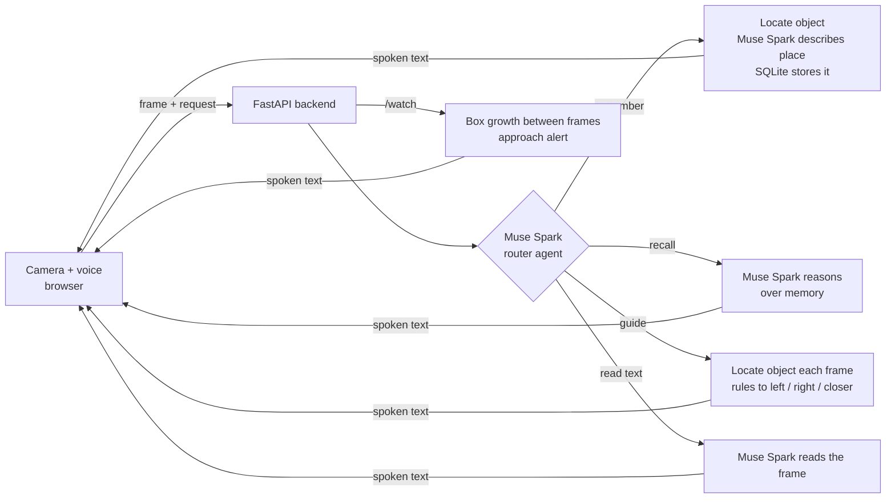

# Lumen

**Lumen helps blind and low-vision people find the things they put down.** It remembers where an
object was left, answers "where are my keys?", then guides the user's hand the last ten feet with
live camera cues. It also warns when something may be approaching and reads text aloud.

Built for the **Meta Global AI Developer Hackathon** (track: *Build for Your World*).

> Knowing your keys are on top of the fridge doesn't help if you can't get to them without sight.
> Lumen closes that gap: **remember, recall, guide, watch.**

## Meta models

Lumen runs on the **Meta Model API** only:

| Model | Used for |
|---|---|
| **SAM 3.1** (`sam-3.1`) | Confirms an object is in view, locates it in every frame, and tracks how fast its box grows. |
| **Muse Spark** (`SPARK_MODEL`, default `muse-spark-1.3`) | Routes the spoken request to a tool, describes where an object is, reasons over memory to answer, and reads text. |

Requests use `store=False`. Use the standard tier, not `*-contributor` models, for real photos.



## Features

- **Remember**: "Remember my keys." The object is located, Muse Spark describes the spot ("on top of the fridge in the kitchen"), and it is stored with a timestamp.
- **Recall**: "Where are my keys?" Muse Spark picks the right remembered item and answers in one spoken sentence.
- **Guide**: a loop of camera frames. The target is located each time and Lumen says "turn a little left", "keep going", "reach straight out".
- **Watch**: warns "Bicycle approaching from your left" when a tracked object's box grows quickly between frames.
- **Read text**: "Read this." Muse Spark reads labels, signs and mail from the camera frame.
- **Router agent** (`/agent`): Muse Spark decides which tool a spoken request needs.

## Built during the hackathon

All application code in this repository was written during the hackathon. The repo was created on
Nov 1, 2026 with only a `.gitignore` and a one-line README; everything else was added after that
(see the commit history).

## Quick start

```powershell
python -m venv .venv
.venv\Scripts\Activate.ps1
pip install -r requirements.txt
Copy-Item .env.example .env          # starts in mock mode, no key needed
python -m uvicorn app.main:app --reload --host 127.0.0.1 --port 8000
```

On macOS or Linux: `source .venv/bin/activate` and `cp .env.example .env`.

Open **http://localhost:8000**, click *Start camera*, then try the phrases on the page. The status
line under the camera says whether you are in **mock mode** (canned answers, images are **not**
analyzed) or **live**. API docs are at `/docs`, and `/health` shows `"mock": false` when live.

### Go live

In `.env` set `MODEL_API_KEY=<your Meta Model API key>` and `LUMEN_MOCK=0`.

Check the connection with one command, then restart the server:

```powershell
python scripts/smoke_test.py photo_of_keys.jpg keys
```

Never commit `.env`. Camera and microphone need `localhost` or HTTPS. Speech input uses the
browser's recognizer (Chrome or Edge), and speech output uses the browser's text-to-speech.

## API

| Endpoint | Input | Output |
|---|---|---|
| `POST /agent` | form: `text`, optional `image` | `tool`, `say`, maybe `start_guide` |
| `POST /remember` | form: `label`, `image` | `saved`, `place`, `say` |
| `POST /recall` | JSON `{"question": "where are my keys?"}` | `found`, `item`, `say` |
| `POST /guide` | form: `target`, `image` (call in a loop) | `say`, `done`, `found` |
| `POST /watch` | form: `session_id`, optional `concepts`, `image` (every ~2 s) | `alerts`, `say` |
| `GET /items`, `GET /health` | | stored items, status |

A failed model call returns a speakable message and an error class instead of crashing; details go
to the server log. `/watch` can make one model call per concept (up to four) per check.

## Tests

```powershell
python -m pytest
```

Covers the SAM output parser (Meta's documented format), the exact SAM and Muse Spark request shapes,
guidance cues, approach alerts, the router, error handling, and every endpoint in mock mode.

## Limitations and safety

- Lumen is an **experimental assistive aid, not a mobility aid**. Never use it in place of a cane, guide dog or other established aid.
- `/watch` compares 2D box sizes between frames. It is not hazard detection, depth sensing or reliable distance estimation, and false or missed alerts are possible. Test it while stationary.
- Cues come from a 2D box; Lumen does not measure distance or detect obstacles.
- Model output can be wrong. Lumen does not give medical advice and does not recognize faces.
- Remembered photos are stored locally in `data/` and are git-ignored.

## License

MIT. See `LICENSE`.